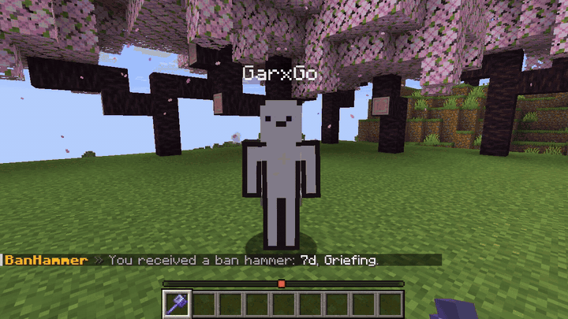
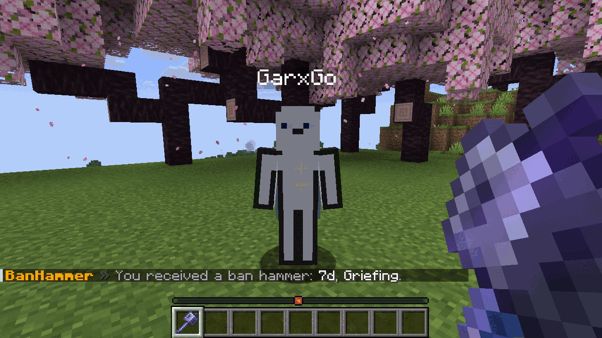
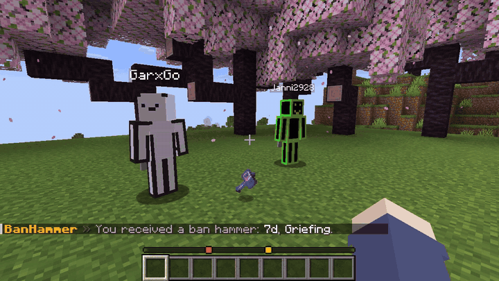

<p align="center">
  <picture>
    <source media="(prefers-color-scheme: dark)" srcset="assets/betterbanhammer-lockup-dark.svg">
    
  </picture>
</p>

<p align="center"><b>An admin ban hammer: hit a player with a mace and they are banned.</b></p>

<p align="center">
  
  
  
  <a href="LICENSE"></a>
</p>

<p align="center">
  <a href="https://modrinth.com/plugin/betterbanhammer">Modrinth</a>
  <a href="https://hangar.papermc.io/YONN2222/BetterBanHammer">Hangar</a>
  <a href="https://github.com/YONN2222/BetterBanHammer/releases">GitHub Releases</a>
</p>

> BetterBanHammer is a small open source admin tool. Give yourself a mace, hit a player and they are banned, with fireworks, particles and sounds at the spot. One jar runs on Spigot, Paper, Purpur and Folia. No accounts, no required dependencies.

Run `/banhammer 7d Griefing` and you get a mace that carries the duration and the reason. Hit a player with it and they are banned for exactly that. Where EssentialsX is installed its `/ban` and `/tempban` are used, otherwise the server ban list.



## Features

- A mace as ban hammer, with the duration and the reason stored in the item
- Works on creative players, which is where a normal hit does not even reach the player
- Uses EssentialsX `/ban` and `/tempban` when EssentialsX is installed, the server ban list otherwise
- Fireworks, particles, sounds and optional lightning at the spot, all configurable
- Admin tool: only holders of `betterbanhammer.use` can ban, players cannot pick the hammer up
- Optional hammers that only work on one chosen player, so a normal player can ban exactly that person
- Free duration input like `30m`, `1h30m`, `7d`, `2w`, `1mo` or `permanent`, a typo never turns into a permanent ban
- Cooldown, sneak requirement, disabled worlds, operator protection, IP bans and a ban log
- 10 languages and every message is editable
- One commented `config.yml` for everything



A hammer for one player works for anybody who holds it. Drop it, let somebody pick it up and they can ban exactly that player:



## Requirements

- Any Bukkit based server on Minecraft 1.21 to 26.3: Spigot, Paper, Purpur, Folia and forks of them
- Java 21 or newer
- EssentialsX is optional

## Quick start

1. Put the jar into `plugins` and start the server.
2. Run `/banhammer 1h Test` in game to get a hammer.
3. Hit a player with it. Done.

Permissions default to operators and work with any permissions plugin. See [Installation](docs/installation.md) for details.

## Documentation

| | Topic | About |
|---|---|---|
| <picture><source media="(prefers-color-scheme: dark)" srcset="assets/icons/install-dark.svg"></picture> | [Installation](docs/installation.md) | Requirements and first steps |
| <picture><source media="(prefers-color-scheme: dark)" srcset="assets/icons/commands-dark.svg"></picture> | [Commands and permissions](docs/commands.md) | Giving hammers, targeted hammers, permissions |
| <picture><source media="(prefers-color-scheme: dark)" srcset="assets/icons/countdown-dark.svg"></picture> | [Effects](docs/effects.md) | Fireworks, particles, sounds, lightning |
| <picture><source media="(prefers-color-scheme: dark)" srcset="assets/icons/methods-dark.svg"></picture> | [EssentialsX](docs/essentials.md) | How bans are executed |
| <picture><source media="(prefers-color-scheme: dark)" srcset="assets/icons/config-dark.svg"></picture> | [Configuration reference](docs/configuration.md) | Every option and its default |
| <picture><source media="(prefers-color-scheme: dark)" srcset="assets/icons/languages-dark.svg"></picture> | [Languages](docs/languages.md) | Ten languages, custom texts, placeholders |
| <picture><source media="(prefers-color-scheme: dark)" srcset="assets/icons/help-dark.svg"></picture> | [Troubleshooting](docs/troubleshooting.md) | Common problems |

## Building

```
./gradlew build
```

The jar ends up in `build/libs`. The plugin targets Java 21.

## Privacy

BetterBanHammer reports anonymous usage statistics to [bStats](https://bstats.org/plugin/bukkit/BetterBanHammer/34929). Turn it off for all plugins in `plugins/bStats/config.yml`. Nothing else leaves your server.

## License

GPL-3.0, see [LICENSE](LICENSE).
